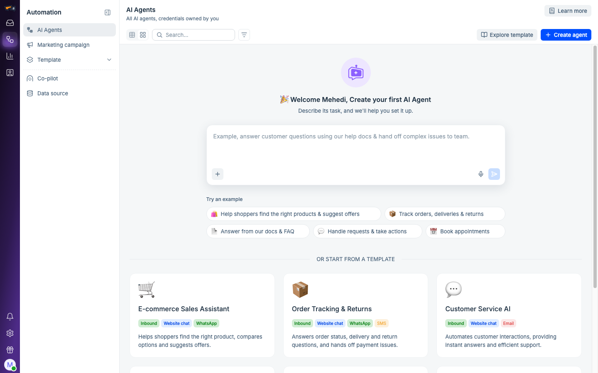
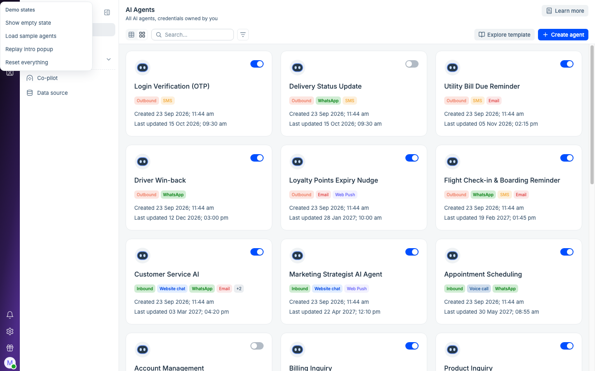
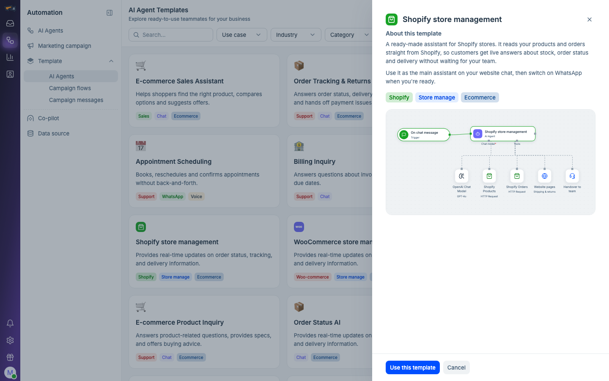
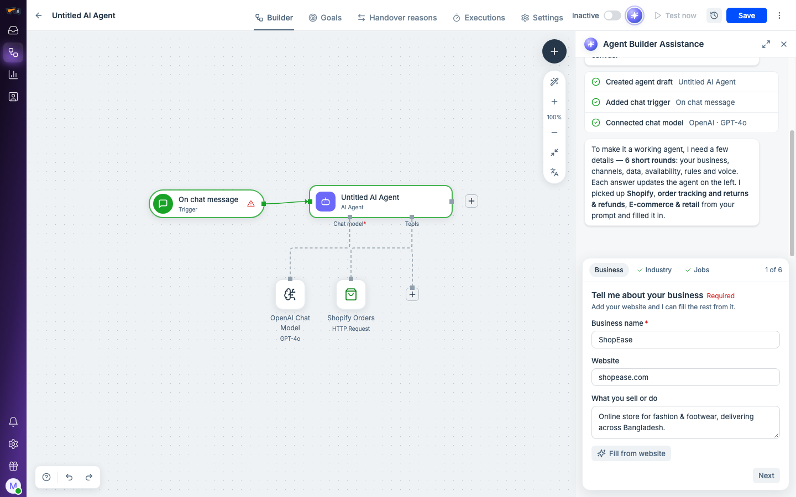
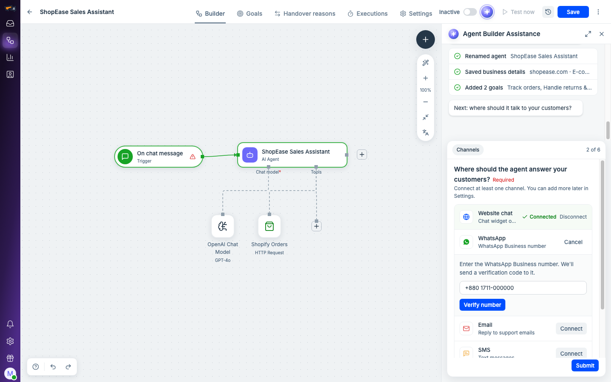
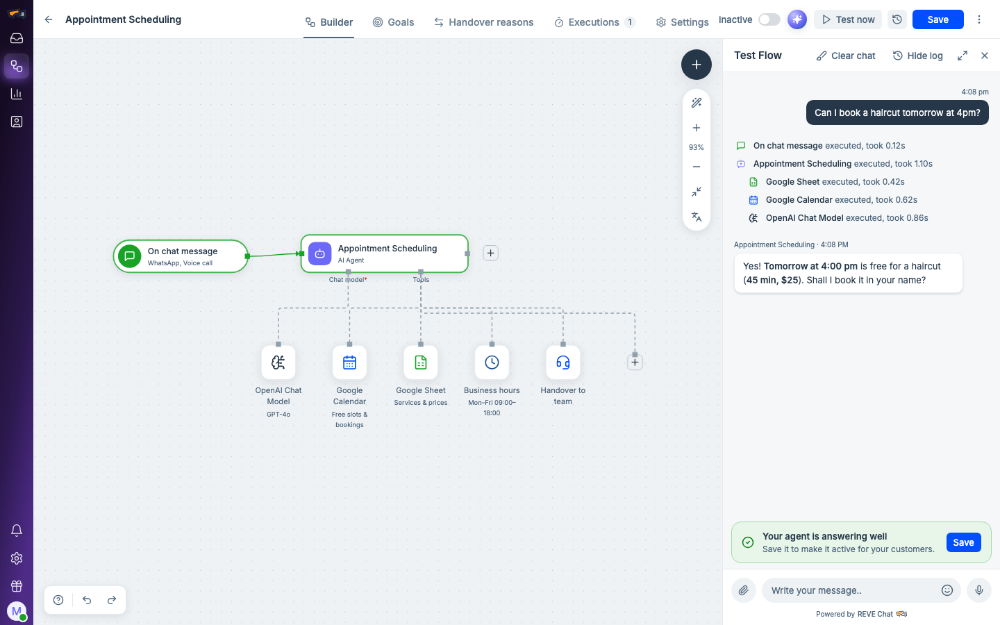

# AI Agent Builder — REVE Chat prototype

A clickable prototype of a **prompt-based AI Agent Builder** for REVE Chat: describe what you want in plain words, and a Builder assistant asks the right questions, connects your channels and tools, and sets up a customer service agent you can test and save.

**▶ Try it live: [ai-agent-builder-prototype.vercel.app](https://ai-agent-builder-prototype.vercel.app)**

No sign-up, nothing to install. Everything is scripted (no LLM or backend), so it behaves the same for everyone. Each visitor's demo data stays in their own browser.



---

## Contents

- [Who it's for](#who-its-for)
- [A 3-minute tour](#a-3-minute-tour)
- [Features](#features)
- [Screenshots](#screenshots)
- [Share it with your team](#share-it-with-your-team)
- [Run it locally](#run-it-locally)
- [How deploys work](#how-deploys-work)
- [Project structure](#project-structure)
- [Design review tools](#design-review-tools)
- [What's real and what's scripted](#whats-real-and-whats-scripted)

## Who it's for

Product, design and engineering teams at REVE Chat who want to **experience** the AI Agent Builder flow end to end before it is built for real: user testing, stakeholder reviews and design iterations.

## A 3-minute tour

1. Open the [live prototype](https://ai-agent-builder-prototype.vercel.app). The first visit shows a short intro.
2. On **AI Agents**, type what your agent should do, or pick an example such as *"Help shoppers find the right products & suggest offers"*, and press Enter.
3. In the builder, the **Builder assistant** walks you through **6 short rounds**: your business, channels, data & integrations, availability, rules & handover, and how it talks. Click **Connect** on a channel or tool to see its connect flow.
4. Watch the **canvas** on the left fill in as you answer.
5. Click **Test now** and chat with your agent as a customer, with a step-by-step execution log.
6. Click **Save**. The first save with setup complete makes the agent **Active**.
7. Or start from one of the **templates** (e.g. *Appointment Scheduling*): it opens ready to test, and **Customize with your info** tailors it.

Tip: the **Prototype** button (bottom-left) switches between the empty state and a list of sample agents, replays the intro, or resets everything.

## Features

### AI Agents
- **First-time view**: the AI agent icon, a prompt box with attachments (file, photo, website link) and voice input, five example prompts, and six starter templates (2 e-commerce, 4 general).
- **Agent list**: grid and table views, search, and colored **direction and channel tags** (Inbound/Outbound, Website chat, WhatsApp, Web push, SMS, Email, Voice call) with "+N" overflow.
- **Create AI Agent** page with the same prompt-first layout.

### Templates
- Gallery with **Use case / Industry / Category** filters and search.
- **Details drawer** with a description, tags and a live flow preview. **Use this template** opens the agent already built.

### Builder
- **Canvas** (React Flow): trigger, AI agent, chat model, tools (store, calendar, CRM, ticketing, website pages), business hours and handover nodes, with run highlighting during tests.
- **Builder assistant**, a Claude-style chat panel:
  - thinking state, word-by-word replies and **action lines** that tick as the agent is changed
  - **question cards** in 6 rounds. Required questions have no Skip, and answers already in your prompt are pre-filled
  - **connect cards** for channels and integrations with realistic flows (install snippet, number verification, forwarding address, sign in with Google/HubSpot, store authorize)
  - a **weekly hours editor** with presets and time zone
  - **Customize with your info** on template agents
- **Test Flow**: chat as a customer with dark user bubbles, replies labelled with the agent's name, and Show/Hide log. **Test now is disabled until setup is finished.** After a good test it suggests saving.
- **Save / Saved**: "Save" when something changed since the last save, "Saved" (disabled) when nothing did. Agents stay inactive until their first complete save.
- **Tabs**:
  - **Goals**, **Handover reasons** and **Executions** (every test run)
  - **Settings**, which holds everything the assistant set up:
    - AI agent profile (avatar, name, designation, description)
    - Other Settings (AI/human priority, chat model)
    - Business, Channels, Data & integrations, Availability, Rules & handover, and Voice
- **Agent types**: e-commerce agents plus four general ones (Customer Service, Appointment Scheduling, Billing Inquiry, Payment & Renewal Reminders), each with its own tools, test questions and replies.

### Design
- Built on the **REVE Chat Design System** (components and tokens). Button labels are sentence case, and disabled buttons use the guideline tints.
- Extra 4px-grid radius tokens and named spacing tokens where the prototype needs in-between values (see `prototype/src/index.css`).

## Screenshots

| Agent list | Templates |
|---|---|
|  |  |
| **Builder: round 1, your business** | **Builder: connecting channels** |
|  |  |

**Test Flow with execution log and the save prompt**



## Share it with your team

| What | How |
|---|---|
| **Public link** | [ai-agent-builder-prototype.vercel.app](https://ai-agent-builder-prototype.vercel.app). Anyone with the link can open it; search engines are asked not to index it. |
| **One HTML file** (works offline, double-click to open) | GitHub → **Actions** → latest *Build downloadable HTML* run → **Artifacts** → `AI-Agent-Builder-Prototype`. Or build it locally (below). |

## Run it locally

Requires Node.js 20+.

```bash
cd prototype
npm install
npm run dev            # http://localhost:5173
```

Other scripts:

```bash
npm run build          # production build → prototype/dist
npm run build:share    # single-file HTML → share/AI-Agent-Builder-Prototype.html (+ share/site/ for static hosting)
```

## How deploys work

- The repo is connected to the Vercel project **ai-agent-builder-prototype** (Vercel's GitHub integration; build settings in [`vercel.json`](vercel.json)).
- **Push to `main`** → Vercel builds and updates the live link in about a minute.
- **Push any other branch or open a PR** → Vercel posts a **preview link** for that branch; the live link changes only after merging.
- The GitHub Action [`build-html.yml`](.github/workflows/build-html.yml) builds the downloadable HTML on every push to `main`.
- No secrets are stored in this repo.

## Project structure

```
.
├── prototype/                 The app (Vite + React + TypeScript + Tailwind 4)
│   ├── src/
│   │   ├── pages/             AI Agents, Create, Templates, Builder
│   │   ├── components/        Agent cards/table, tags, starter (prompt box + templates), avatar, intro
│   │   ├── builder/           Canvas, assistant panel, chat cards, setup rounds (script.ts), agent profiles, tabs
│   │   ├── data/              Sample agents, templates, example prompts
│   │   ├── store/             App state (saved in the browser)
│   │   └── ds/                REVE Chat Design System bundle and tokens
│   └── scripts/               Single-file export, style audit, Figma capture, README screenshots
├── design-system/             Design system reference files
├── docs/                      Prototype spec and README screenshots
├── research/                  Inspiration notes and wireframe crops
├── reports/                   Style and button audit pages, Figma sync map
├── vercel.json                Vercel build settings
└── .github/workflows/         Build of the downloadable HTML
```

**Tech:** React 18, React Router 6 (hash routes in the shared build), @xyflow/react 12 for the canvas, lucide-react icons, Tailwind CSS 4 mapped to REVE Chat tokens, Vite 5 (with `vite-plugin-singlefile` for the one-file export).

## Design review tools

- **Style audit**: every color, text style, spacing, radius and shadow in the code, checked against the design system tokens.
  ```bash
  cd prototype
  python3 -I scripts/style-audit.py src ../reports/style-audit.json
  python3 -I scripts/style-audit-report.py ../reports/style-audit.json ../reports/style-audit.html
  ```
- **Button audit**: every button compared with the REVE Chat Button guidelines (`reports/button-audit.html`).
- **Figma round trip**: the main screens are captured into Figma (`AI-Agent` file, page *Lab 2*, section *From Claude*) with a locked baseline copy. Design edits made there are read back and applied to the code (`reports/figma-sync.json`, `prototype/scripts/figma-capture.mjs`).
- **README screenshots**: `node prototype/scripts/readme-screenshots.mjs` retakes them from the live site.

## What's real and what's scripted

| Real | Scripted (fake but realistic) |
|---|---|
| All screens, navigation, forms, tabs and settings | The Builder assistant's replies and question rounds |
| The canvas and how it changes with your answers | Connect flows (no real Shopify, WhatsApp, Google… accounts) |
| Save / Saved state, active switch, agent list | Test replies and execution logs |
| Data saved in your browser (per visitor) | "Fill from website" and voice input (browser speech, where supported) |

---

Built by **Mehedi Hasan Mamun** with Claude Code.
